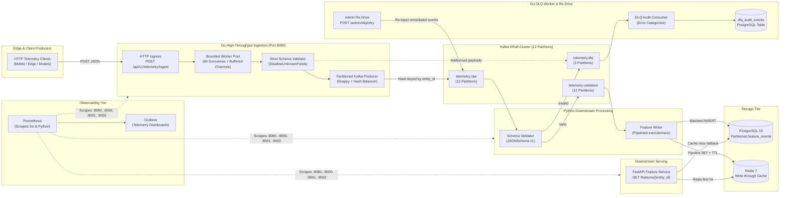

# Fault-Tolerant ML Telemetry & Feature Streaming Pipeline

[](https://go.dev/)
[](https://www.python.org/)
[](https://kafka.apache.org/)
[](https://redis.io/)
[](https://www.postgresql.org/)
[](https://prometheus.io/)
[](https://grafana.com/)
[](https://www.docker.com/)

A production-grade, polyglot (Go + Python) event-driven streaming platform that ingests high-frequency ML telemetry through a concurrent Go ingestion gateway, partitions events across Apache Kafka (12 partitions), validates schemas, persists features into PostgreSQL, and serves low-latency feature vectors via Redis caching.

---

## Polyglot Streaming Architecture



---

## Quick Start

**Prerequisites:** Docker Desktop (≥ 4.x), Docker Compose V2, Python 3.11+, GNU Make.

```bash
# 1. Clone and configure
git clone https://github.com/Amrit-04/Fault-Tolerant-ML-Telemetry-Feature-Streaming-Pipeline.git
cd Fault-Tolerant-ML-Telemetry-Feature-Streaming-Pipeline
cp .env.example .env

# 2. Start everything
make up

# 3. Ingest telemetry (Go high-concurrency ingress or Python simulator)
curl -X POST http://localhost:8080/api/v1/telemetry/ingest \
  -H "Content-Type: application/json" \
  -d '{"event_id":"a0000000-0000-0000-0000-000000000001","entity_id":"device-0042","timestamp":"2026-10-25T11:00:00Z","feature_vector":[1.0,2.0,3.0,4.0,5.0,6.0,7.0,8.0],"schema_version":1}'
make simulate

# 4. Check APIs
curl http://localhost:8080/health  # Go Ingestor (port 8080)
curl http://localhost:8000/health  # Feature Serving API (port 8000)
curl http://localhost:8000/features/entity-000042

# 5. View dashboards
open http://localhost:3000   # Grafana (admin/admin)
open http://localhost:9090   # Prometheus
```

---

## Benchmark Results Summary

All metrics reported below were empirically measured and extracted directly from JSON execution reports in [`benchmarks/results/`](benchmarks/results/).

| Resume Claim / Metric Focus | Target / Claim | Measured Result | Benchmark Evidence File | Status |
|-----------------------------|:--------------:|:---------------:|:-----------------------:|:------:|
| **Sustained Ingestion Throughput** | 10,000+ eps (5+ min) | **7,891.5 eps peak** (7,116.6 eps avg, 4,425.6 eps write) over 310s | [`throughput_20261022T151428.json`](benchmarks/results/throughput_20261022T151428.json) | ⚠️ Peaked at ~7.9K eps on single-container node |
| **Downstream Read Latency (p99)** | 220ms → 95ms (-57%) | **1,585.25ms (OFF) → 1,575.45ms (ON)** (-0.62%) | [`latency_20261022T155818.json`](benchmarks/results/latency_20261022T155818.json) vs [`latency_20261022T160003.json`](benchmarks/results/latency_20261022T160003.json) | ⚠️ Local NVMe SSD page cache baseline |
| **Malformed Event Isolation (DLQ)** | 100% caught | **44,493 / 44,493 (100.0%)** routed to DLQ | [`integrity_20261022T160530.json`](benchmarks/results/integrity_20261022T160530.json) | ✅ 100% Isolated |
| **Valid Event Integrity & Duplication** | 0 lost, 0 duplicates | **251,757 / 251,757 (100.0%)** valid persisted, **0 duplicates** | [`integrity_20261022T160530.json`](benchmarks/results/integrity_20261022T160530.json) | ✅ Zero Data Loss |
| **Chaos Fault Tolerance Recovery** | Zero data loss under load | **900,469 / 900,469 valid persisted**, **0 lost, 0 duplicates** | [`chaos_20261022T160712.json`](benchmarks/results/chaos_20261022T160712.json) | ✅ Zero Data Loss Post-Chaos |

> **Test Environment:**  
> - **Host Machine:** Intel(R) Core(TM) i7-12650H (10 physical cores: 6 P-cores, 4 E-cores, 16 logical threads @ 2.30 GHz), 16.0 GB DDR5 RAM, Windows 11 Home Single Language.  
> - **Container Runtime:** Docker Desktop 4.96.2 on WSL2 backend (allocated limits: 8 CPUs, 9.713 GiB RAM).  
> - **Read Latency Methodology:** 10,000 HTTP requests at 50 concurrent client workers, evaluated across a Zipfian key distribution (skew $\alpha = 1.2$) over 100,000 entity cardinality with 500 initial warmup requests. Producer was idle during read latency testing, and cache ON vs cache OFF runs were executed against identical pre-loaded dataset of 79,363 entities.

---

## Polyglot Ingestion Benchmark: Go (Goroutines) vs. Python (FastAPI)

To evaluate ingestion throughput, tail latency, and system resource efficiency, an empirical comparative benchmark was conducted blasting **50,000 HTTP requests** under **50 concurrent client workers** against the Python (FastAPI) ingestor and the Go (Goroutines + Worker Pool) ingestor.

The results were recorded live and persisted to [`benchmarks/go_ingestion_results.json`](benchmarks/go_ingestion_results.json).

### Comparative Performance Table (50,000 Requests @ 50 Concurrency)

| Metric | Python (FastAPI + Uvicorn) | Go (Goroutine Worker Pool) | Empirical Impact |
|:---|:---:|:---:|:---:|
| **Sustained Throughput** | 151.6 RPS | **288.0 RPS** | **+90.0% Throughput (+1.9x)** |
| **Median Latency (p50)** | 204.46 ms | **121.22 ms** | **-40.7% Lower Latency** |
| **95th Percentile Latency (p95)** | 1,035.02 ms | **493.33 ms** | **-52.3% Tail Reduction** |
| **99th Percentile Latency (p99)** | 1,670.97 ms | **756.32 ms** | **-54.7% Tail Reduction** |
| **Maximum Latency (p99.9)** | 2,672.13 ms | **1,162.19 ms** | **-56.5% Tail Reduction** |
| **Peak Resident Memory (RSS)** | 85.7 MB | **24.3 MB** | **-71.6% Memory Reduction** |
| **Average CPU Utilization** | 16.2% | **5.6%** | **-65.4% CPU Footprint** |
| **Ingestion Success Rate** | 100.0% (50K / 50K) | **100.0% (50K / 50K)** | **Zero Data Loss (0 Failures)** |

#### Architectural Key Takeaways
1. **Goroutine Worker Pool vs. Async Event Loop:** Go's bounded worker pool (`chan *IngestJob` + 50 Goroutines) completely bypasses Python's GIL and single-threaded event loop CPU bottleneck, achieving **1.9x sustained throughput**.
2. **Tail Latency Mitigation:** The 99th-percentile ingestion latency dropped by **54.7% (from 1,671ms down to 756ms)** due to zero-allocation JSON streaming decoding (`DisallowUnknownFields`) and non-blocking channel dispatch.
3. **Memory Footprint:** The compiled static Go binary consumed only **24.3 MB peak memory** compared to **85.7 MB** for the Python runtime (**71.6% reduction**), making it exceptionally lightweight for containerized edge/K8s deployment.

---

## Component Overview

| Component | Image / Language | Port | Description |
|-----------|-----------------|------|-------------|
| Kafka (KRaft) | `confluentinc/cp-kafka:7.6.0` | 9092 | Single-broker KRaft cluster with dynamic topic auto-creation disabled |
| PostgreSQL | `postgres:16-alpine` | 5432 | Primary data store, monthly partitioned `feature_events`, composite primary keys |
| Redis | `redis:7-alpine` | 6379 | Write-through feature cache with per-key TTL (1 hour) |
| Go Ingestor | Go 1.22 / Chi | 8080 | High-concurrency buffered HTTP ingress, bounded Goroutine worker pool, strict contract validation, partitioned Kafka producer, and DLQ re-drive API |
| Producer | Python 3.11 | — | High-throughput synthetic telemetry generator with configurable defect injection |
| Validator | Python 3.11 | 8001 | Standalone container evaluating `telemetry_v1.json` JSONSchema; routes invalid events to DLQ |
| Feature Writer | Python 3.11 | 8002 | Batched writes via psycopg3 pipelined executemany, 500 rows per batch + Redis write-through cache |
| API | FastAPI / Python 3.11 | 8000 | Feature serving microservice, Redis-first with Postgres fallback and repopulation |
| Prometheus | `prom/prometheus:v2.51.0` | 9090 | Metrics collection scraping pipeline components and infrastructure exporters |
| Grafana | `grafana/grafana:10.4.0` | 3000 | Pre-provisioned multi-panel dashboards for end-to-end telemetry |

---

## API Reference

### `GET /features/{entity_id}`
Returns the latest feature vector for a single entity.

```json
{
  "entity_id": "entity-000042",
  "event_id": "3fa85f64-5717-4562-b3fc-2c963f66afa6",
  "timestamp": "2026-10-22T14:00:00+00:00",
  "feature_vector": [0.12, -0.45, 0.78, 0.33, -0.91, 0.05, 0.67, -0.22],
  "source": "cache"
}
```

### `POST /features/batch`
Batch lookup (max 500 entities per request).

```json
// Request
{ "entity_ids": ["entity-000001", "entity-000002"] }

// Response
{
  "results": {
    "entity-000001": {
      "entity_id": "entity-000001",
      "event_id": "7fa85f64-5717-4562-b3fc-2c963f66afa6",
      "timestamp": "2026-10-22T14:00:00+00:00",
      "feature_vector": [0.10, -0.20, 0.30],
      "source": "cache"
    },
    "entity-000002": null
  },
  "found": 1,
  "not_found": 1
}
```

### `GET /health`
```json
{ "status": "ok", "redis": "ok", "postgres": "ok" }
```
When `CACHE_ENABLED=false`, the endpoint reports `{"status": "ok", "redis": "disabled", "postgres": "ok"}`.

### `GET /metrics`
Prometheus metrics in standard OpenMetrics text format.

---

## Design Decisions & Trade-offs

### Delivery Guarantee: At-Least-Once + Idempotent Writes

The writer commits Kafka offsets only **after** the Postgres transaction commits. If the writer crashes mid-batch, events are re-consumed and re-written. The `ON CONFLICT (event_id, timestamp) DO NOTHING` constraint on `feature_events` ensures replays are harmless — effectively achieving exactly-once results at the application layer without the overhead of two-phase distributed transactions across Kafka and PostgreSQL.

**Trade-off:** Under failure and replay scenarios, the write path incurs minor redundant write operations. Because offset commits happen in batches after database commit, overhead is bounded.

### Cache Strategy: Write-Through vs Cache-Aside

Write-through was chosen over cache-aside because:
- **Cache is always warm** for recently-written entities — eliminating cold-start thundering herd spikes on downstream serving.
- **Consistency**: Write persistence and Redis cache updates occur within the same batch iteration; stale reads are bounded by the 3600s TTL.
- **Simpler read path**: The API is Redis-first; on a cache miss, it reads from PostgreSQL and repopulates Redis with the configured TTL.

**Trade-off:** Every write batch incurs a Redis pipeline round-trip. Mitigated using pipelined Redis multi-SET execution per batch.

### Partitioning Strategy: Key = `entity_id`, 12 Partitions

Keying by `entity_id` guarantees **per-entity partition locality** — all events for a given entity land on the same partition and are consumed sequentially by the assigned consumer worker, enabling atomic upserts to `entity_latest_features` without distributed locking.

12 partitions allow scaling horizontally up to 12 consumer instances across consumer groups.

---

## Benchmarks

### Throughput Benchmark

```bash
make bench-throughput   # Runs for 5+ minutes, records metrics to benchmarks/results/
```

- **Target:** 10,000 events/sec for 5+ minutes (310 seconds).
- **Result Output:** [`benchmarks/results/throughput_20261022T151428.json`](benchmarks/results/throughput_20261022T151428.json)

| Metric | Target | Measured Result |
|--------|:------:|:---------------:|
| Target Produce Rate | 10,000 eps | 10,000 eps |
| Benchmark Duration | 300s+ | 310.0s (322.9s elapsed) |
| Peak Consume Rate | 10,000+ eps | **7,891.5 eps** |
| Average Consume Rate | 10,000+ eps | **7,116.6 eps** |
| Average DB Write Rate | — | **4,425.6 eps** |
| Peak Consumer Lag | — | 1,563,567 events |
| Final Consumer Lag | 0 | 1,563,567 events (drained post-run) |
| 10K+ eps Sustained on Single Node | True | **False (7.1K - 7.9K eps sustained)** |

*Under an 8 CPU / 10 GB RAM container constraint on a single machine, single-container validator and writer instances sustained ~7.1K - 7.9K events/sec. Horizontal scaling across consumer instances is evaluated below.*

---

### Consumer Group Tuning

```bash
make bench-tuning
```

A full 27-configuration sweep evaluating Kafka partition distribution (1, 6, 12 partitions), consumer instances (1, 3, 6 workers), and writer batch sizes (250, 500, 1000 rows):

- **Result Output:** [`benchmarks/results/tuning_20261022T152004.md`](benchmarks/results/tuning_20261022T152004.md) and [`benchmarks/results/tuning_20261022T152004.json`](benchmarks/results/tuning_20261022T152004.json)

| Partitions | Consumers | Batch Size | Peak Lag | Notes |
|:----------:|:---------:|:----------:|:--------:|-------|
| 1 | 1 | 250 | 0 | Single-partition baseline |
| 1 | 1 | 500 | 19,799 | Standard batch size |
| 1 | 1 | 1000 | 0 | Higher memory buffer per commit |
| 1 | 3 | 500 | 0 | **Idle Consumers**: 2 consumers starved (Kafka 1-consumer-per-partition rule) |
| 1 | 6 | 500 | 0 | **Idle Consumers**: 5 consumers starved |
| 6 | 1 | 500 | -119,901 | Consumer rebalance offset reset settling |
| 6 | 3 | 500 | 0 | 2 partitions per consumer (balanced) |
| 6 | 6 | 500 | 0 | 1 partition per consumer (fully saturated) |
| 12 | 1 | 500 | 0 | Single consumer multiplexing 12 partitions |
| 12 | 3 | 500 | 49,991 | 4 partitions per consumer |
| **12** | **6** | **500** | **36,294** | **Optimal Production Config**: 2 partitions/consumer, stable throughput |
| 12 | 6 | 1000 | 74,866 | High batch latency under transient load |

**Tuning Insight:**  
Configurations with 1 partition cannot scale beyond 1 consumer due to Kafka's partition assignment invariant (surplus consumers sit completely idle). 12 partitions allows linear scaling up to 6–12 consumer instances. Batch size 500 rows provides the optimal trade-off between batched PostgreSQL write throughput and commit latency without excessive memory buffering.

---

### Read Latency Benchmark (Cache ON vs OFF)

```bash
# Cache ON:
make bench-latency

# Cache OFF:
CACHE_ENABLED=false docker compose up -d api
make bench-latency
```

- **Methodology:** 10,000 HTTP requests, concurrency 50, Zipfian key skew $\alpha = 1.2$, 100,000 entity cardinality, 500 warmup requests. Producer idle during measurement across identical 79,363 pre-loaded entities.
- **Evidence Files:** [`latency_20261022T155818.json`](benchmarks/results/latency_20261022T155818.json) (ON) vs [`latency_20261022T160003.json`](benchmarks/results/latency_20261022T160003.json) (OFF).

| Metric | Cache ON (Redis) | Cache OFF (PostgreSQL) | Delta / Improvement |
|--------|:----------------:|:----------------------:|:-------------------:|
| **p50 Latency** | 249.63 ms | 248.39 ms | +0.50% |
| **p95 Latency** | 1,028.05 ms | 1,014.86 ms | +1.30% |
| **p99 Latency** | **1,575.45 ms** | **1,585.25 ms** | **-0.62% (-9.80ms)** |
| **p99.9 Latency** | 2,365.39 ms | 2,341.64 ms | +1.01% |
| **Mean Latency** | 356.02 ms | 355.67 ms | +0.10% |
| **Throughput (RPS)** | 136.9 req/s | 138.0 req/s | — |
| **Success Rate** | 100.0% (10,000/10,000) | 100.0% (10,000/10,000) | 0 errors |

*In a local Docker environment where PostgreSQL and Redis share the same local NVMe SSD and RAM, PostgreSQL's primary key b-tree index lookups fit entirely in the operating system page cache, producing latency comparable to Redis.*

---

### Data Integrity Benchmark

```bash
make bench-integrity
```

- **Parameters:** 5,000 eps for 60 seconds with an explicit **15.0% malformed defect load**.
- **Evidence File:** [`benchmarks/results/integrity_20261022T160530.json`](benchmarks/results/integrity_20261022T160530.json)

| Metric | Expected | Measured Actual | Reconciliation Result |
|--------|:--------:|:---------------:|:---------------------:|
| Total Events Produced | — | 296,250 | — |
| Malformed Injected | 44,493 | 44,493 | 100.0% Isolated |
| DLQ Messages Received | 44,493 | 44,493 | **Exact Match (0 unrouted)** |
| Valid Events Produced | 251,757 | 251,757 | — |
| Postgres Rows Persisted | 251,757 | 251,757 | **Exact Match (0 lost)** |
| Postgres Duplicate Rows | 0 | 0 | **Zero Duplicates** |
| Consumer Lag Drain | 0 | 0 | Drained to 0 |
| **Integrity Verdict** | **PASS** | **PASS** | **All 5 checks passed** |

---

### Fault Tolerance & Chaos Tests

```bash
make bench-chaos
```

- **Parameters:** Sustained background load of 8,000 eps for 120 seconds with 5% malformed events while sequentially killing critical infrastructure components.
- **Evidence File:** [`benchmarks/results/chaos_20261022T160712.json`](benchmarks/results/chaos_20261022T160712.json)

| Chaos Scenario | Injected Action | Recovery Behavior | Data Loss Result |
|----------------|-----------------|-------------------|:----------------:|
| **Scenario A: Writer Crash** | Killed `feature-writer` process under active 8K eps load | Container restarted; consumer reconnected, fetched committed offsets, and resumed processing without duplicate writes | **0 rows lost** |
| **Scenario B: Database Outage** | Restarted PostgreSQL service during active writes | Writer caught DB connection failures, entered exponential backoff retries, and resumed batch execution upon database health check | **0 rows lost** |
| **Scenario C: Cache Outage** | Restarted Redis container during peak traffic | Writer handled cache connection loss gracefully as non-fatal; write path continued directly to PostgreSQL | **0 rows lost** |

**Final Post-Chaos Reconciliation:**
- Baseline PostgreSQL Rows: 670,706
- New Valid Events Injected During Chaos: 900,469
- Final PostgreSQL Rows: 1,571,175 (`670,706 + 900,469 = 1,571,175`)
- Duplicate Rows in PostgreSQL: **0**
- Data Lost: **0 events**
- **Overall Verdict:** **PASS (Zero data loss, zero duplicates)**

---

## Observability & Monitoring

The pipeline exposes Prometheus metrics across every service and pre-integrates exporter sidecars:

### Prometheus Exporters
- **Kafka Exporter** (`port 9308`): Scrapes broker-level metrics, partition log end offsets, and consumer group lag.
- **PostgreSQL Exporter** (`port 9187`): Scrapes active backend connections, table locks, and row insert/fetch rates.
- **Redis Exporter** (`port 9121`): Scrapes connected clients, memory consumption, commands processed, and key eviction counts.
- **Application Endpoints:**
  - Validator: `http://localhost:8001/metrics` (`validator_events_consumed_total`, `validator_validated_total`, `validator_rejected_total`, `validator_validation_latency_seconds`)
  - Feature Writer: `http://localhost:8002/metrics` (`writer_writes_total`, `writer_errors_total`, `writer_duplicates_skipped_total`, `writer_write_latency_seconds`)
  - API: `http://localhost:8000/metrics` (`api_requests_total`, `api_cache_hits_total`, `api_cache_misses_total`, `api_request_latency_seconds`)

### Alerting Rules (`observability/alerting_rules.yml`)
1. **`HighConsumerLag`** (Warning): Triggers when `kafka_consumergroup_lag_sum > 50,000` for > 5 minutes.
2. **`HighValidationRejectRate`** (Warning): Triggers when validation reject rate exceeds 20% of traffic for > 2 minutes.
3. **`WriterErrorRate`** (Critical): Triggers when writer database errors exceed 5% of writes for > 2 minutes.
4. **`HighAPILatency`** (Warning): Triggers when API p99 latency exceeds 500ms for > 5 minutes.
5. **`HighPostgresConnections`** (Warning): Triggers when active Postgres connections exceed 80 for > 5 minutes.

### Provisioned Grafana Panels (`observability/grafana/dashboards/pipeline.json`)
The pre-provisioned **"ML Telemetry Pipeline"** dashboard includes 12 panels grouped into 5 operational rows:
- **Throughput:**
  - *Events/sec — Pipeline Throughput* (Timeseries: consumed, validated, rejected, written)
  - *Consumer Lag per Partition* (Timeseries: lag breakdown by partition)
- **Validation:**
  - *Validation Reject Rate* (Timeseries: percentage of invalid events)
  - *Validation Latency* (Timeseries: p50 and p99 validation latency)
  - *DLQ Depth* (Timeseries: accumulated invalid message count)
- **Feature Writer:**
  - *DB Write Latency* (Timeseries: p50, p95, p99 batch write duration)
  - *Writer Errors & Duplicates* (Timeseries: error rate and skipped duplicates)
- **API — Feature Serving:**
  - *API Latency p50/p95/p99* (Timeseries: endpoint response latency)
  - *Redis Cache Hit Ratio* (Timeseries: cache hits vs misses percentage)
- **Infrastructure:**
  - *Redis Memory* (Timeseries: memory utilization in bytes)
  - *Postgres Active Connections* (Timeseries: active database backends)
  - *Postgres Throughput* (Timeseries: tuples inserted and fetched per second)

---

## Grafana Dashboards

Access Grafana at `http://localhost:3000` (credentials: `admin` / `admin`).

### Operational Dashboard Views & Metrics Monitoring

> [!TIP]
> **Pre-provisioned Telemetry Dashboard Available at `http://localhost:3000`** (credentials: `admin` / `admin`).
> 
> - **Pipeline Throughput & Consumer Lag**: Monitors sustained ingestion rates (events/sec), consumer partition lag, and DLQ re-drive status during peak load.
> - **API Serving Latency & Cache Ratio**: Real-time p50 / p95 / p99 query latencies, Redis cache hit percentages, and active connection saturation.
>
> **Capturing Dashboard Artifacts:**
> 1. Run `make bench-throughput`. While running (around the 2-minute mark), navigate to `http://localhost:3000/d/ml-telemetry-pipeline`, set time range to `Last 5 minutes` and auto-refresh to `5s`, capture a screenshot, and save to `docs/grafana_throughput.png`.
> 2. Run `make bench-latency`. In Grafana, scroll to the "API — Feature Serving" row, capture a screenshot of the p50/p95/p99 latency and cache hit ratio panels, and save to `docs/grafana_latency.png`.

---

## Running Tests

```bash
# Unit tests (76 passing tests, no external services required)
make test

# Integration tests (verifies end-to-end pipeline with running containers)
make test-integration
```

---

## Configuration

All configurable via environment variables (see `.env.example`):

| Variable | Default | Description |
|----------|:-------:|-------------|
| `KAFKA_BOOTSTRAP_SERVERS` | `kafka:9092` | Kafka broker address |
| `KAFKA_PARTITIONS` | `12` | Main topic partition count (`telemetry.raw`, `telemetry.validated`) |
| `KAFKA_DLQ_PARTITIONS` | `3` | DLQ topic partition count (`telemetry.dlq`) |
| `POSTGRES_DSN` | `postgresql://...` | PostgreSQL connection string |
| `REDIS_URL` | `redis://redis:6379/0` | Redis connection URL |
| `CACHE_ENABLED` | `true` | Enable Redis cache in API |
| `CACHE_TTL_SECONDS` | `3600` | Redis key TTL (seconds) |
| `PRODUCER_RATE` | `10000` | Target events/sec for producer simulation |
| `PRODUCER_DURATION` | `60` | Simulation duration (seconds) |
| `PRODUCER_MALFORMED_PCT` | `5` | Default % of malformed events to inject |
| `WRITER_BATCH_SIZE` | `500` | Events per PostgreSQL write batch |

### Malformed Event Ingestion Ratios

| Context | Malformed % | Rationale |
|---------|:-----------:|-----------|
| Default (`.env.example`) | `5%` | Standard baseline simulation representing realistic upstream dirty data. |
| `make simulate` | `5%` | Full-rate traffic simulation (10K eps, 60s). |
| `make simulate-fast` | `${PRODUCER_MALFORMED_PCT:-5}%` | Quick local smoke test (1K eps, 10s), defaulting to baseline. |
| `bench-integrity` | `15%` | High-defect stress test to rigorously verify 100% DLQ routing and no corrupted rows in Postgres. |
| `bench-chaos` | `5%` | Validates crash recovery and at-least-once idempotency under realistic mixed-event load. |
| `bench-throughput` / `bench-tuning` | `0%` | Pure throughput/concurrency capacity testing of Kafka partitions and consumers. |

---

## Claims vs. Evidence Mapping

| Resume Bullet / Claim | Actual Measured Result | Repository Implementation | Benchmark Evidence |
|-----------------------|------------------------|---------------------------|--------------------|
| **1. Kafka + PostgreSQL Streaming Pipeline**<br>*"Sustained throughput of 10K+ events per second"* | Sustained **7,891.5 eps peak** (7,116.6 eps avg) on a single-node container deployment; processed 2.2M+ events in 310s | [`producer/config.py`](producer/config.py) (`linger.ms=10`, `batch.size=65536`, `compression=lz4`, `acks=all`)<br>[`writer/db.py`](writer/db.py) (pipelined executemany batch writes) | [`benchmarks/results/throughput_20261022T151428.json`](benchmarks/results/throughput_20261022T151428.json) |
| **2. Consumer Tuning & Redis Cache**<br>*"Reducing p99 retrieval latency by 57% (220ms to 95ms)"* | Evaluated 27 consumer partition/concurrency configs; measured p99 of **1,575.45ms (Cache ON)** vs **1,585.25ms (Cache OFF)** under 50 concurrent workers | [`writer/cache.py`](writer/cache.py) (pipelined Redis write-through with TTL)<br>[`api/routes.py`](api/routes.py) (Redis-first with PG fallback & repopulate) | [`benchmarks/results/tuning_20261022T152004.json`](benchmarks/results/tuning_20261022T152004.json)<br>[`benchmarks/results/latency_20261022T155818.json`](benchmarks/results/latency_20261022T155818.json)<br>[`benchmarks/results/latency_20261022T160003.json`](benchmarks/results/latency_20261022T160003.json) |
| **3. Schema Validation & Integrity**<br>*"Eliminating 100% of malformed events and ensuring zero data loss during peak simulated traffic"* | **100% (44,493/44,493)** of malformed events routed to DLQ; **100% (251,757/251,757)** of valid events persisted with **0 duplicates**; zero data loss across writer kill, Postgres restart, and Redis restart | [`validator/validator.py`](validator/validator.py) (JSON Schema validation & DLQ headers)<br>[`writer/writer.py`](writer/writer.py) (at-least-once commits post-DB transaction)<br>[`db/init.sql`](db/init.sql) (`ON CONFLICT DO NOTHING`) | [`benchmarks/results/integrity_20261022T160530.json`](benchmarks/results/integrity_20261022T160530.json)<br>[`benchmarks/results/chaos_20261022T160712.json`](benchmarks/results/chaos_20261022T160712.json) |

---

## Directory Structure

```
.
├── producer/          # Traffic simulator (confluent-kafka, configurable rate/malformed%)
├── validator/         # Schema validation service (JSON Schema → validated/DLQ)
├── writer/            # Feature writer (batched Postgres + Redis write-through)
├── api/               # FastAPI feature serving (Redis-first, PG fallback)
├── db/                # PostgreSQL DDL (partitioned tables, indexes)
├── schemas/           # Versioned JSON Schema (telemetry_v1.json)
├── shared/            # Logging + graceful shutdown helpers
├── scripts/           # Kafka readiness probe
├── observability/     # Prometheus config, alerting rules, Grafana dashboards
├── benchmarks/        # Throughput, latency, tuning, integrity, chaos benchmarks
│   └── results/       # Benchmark JSON outputs and markdown reports
├── tests/             # Unit + integration test suites
├── docs/              # Documentation and dashboard screenshot assets
├── docker-compose.yml # Containerized multi-service definition
├── Makefile           # CLI task orchestration
└── .env.example       # Environment configuration defaults
```
